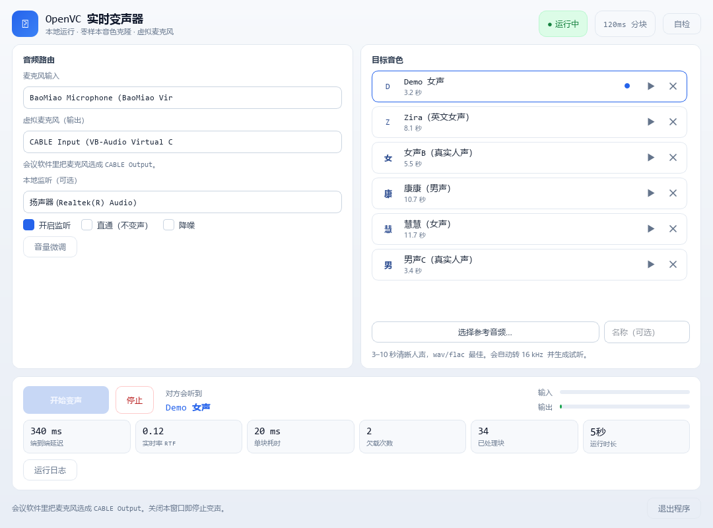

# OpenVC

把麦克风里的声音**实时**换成另一个人的音色，再通过虚拟声卡喂给腾讯会议 / Zoom / Teams / Discord。
全部本地运行，不联网，不需要 GPU，不需要装 Python，不需要 PyTorch。

[](https://github.com/chenziwenhaoshuai/OpenVC/releases)
[](https://github.com/chenziwenhaoshuai/OpenVC/releases)
[]()
[]()
[]()



---

## 下载

到 [**Releases**](https://github.com/chenziwenhaoshuai/OpenVC/releases) 下载 `OpenVC-1.0.0.zip`（170 MB），解压到任意位置（**不要放 Program Files**）。

## 三步开始

1. **装驱动**：解压 `驱动\VBCABLE_Driver_Pack45.zip`，右键 `VBCABLE_Setup_x64.exe` → 以管理员身份运行 → Install Driver → **重启电脑**
2. **双击 `OpenVC.exe`**，选一个目标音色（点 ▶ 可以先试听）
3. 点「开始变声」，然后在会议软件里把**麦克风**选成 `CABLE Output`

> 注意区分：变声器输出选 `CABLE Input`（送进去），会议软件麦克风选 `CABLE Output`（取出来）。选反了对方听不到。

## 特性

| | |
|---|---|
| **零样本** | 上传 3–10 秒任意人的干净录音即可克隆音色，不用训练 |
| **低延迟** | 端到端约 340–420 ms，120 ms 分块 |
| **CPU 实时** | 核显笔记本也能跑，实时率 RTF 0.13（开降噪 0.35） |
| **降噪** | 内置 DeepFilterNet3，压键盘声 / 风扇声 / 街道噪声 |
| **6 个内置音色** | 每个都能试听**真实转换后**的效果，不是原声 |
| **一键自检** | 播测试音进虚拟声卡再从 `CABLE Output` 录回来，验证整条链路 |
| **热切换** | 运行中直接点另一个音色，自动切换 |
| **原生界面** | Qt 6 桌面程序，不是浏览器套壳 |

## 性能

测试环境：Intel Iris Xe 核显笔记本，无独显，单线程推理。

| 指标 | 数值 |
|---|---|
| 单块耗时 | 18–28 ms / 160 ms |
| 实时率 RTF | 0.13 |
| 端到端延迟 | 342 ms |
| 内存占用 | 257 MB |
| 冷启动 | 1.1 s 出窗口 |
| 包体 | 338 MB |

**音质**（与官方 Demo 逐条对比）

| 测试对 | 说话人相似度 | 梅尔谱相关 | F0 源 → 官方 → 我们 |
|---|---|---|---|
| 00019809-400006 | 0.872 | 0.823 | 145 → 246 → 239 Hz |
| 040_001-MF6 | 0.840 | 0.840 | 239 → 242 → 242 Hz |
| 00020170-VCF1 | 0.813 | 0.852 | 205 → 137 → 144 Hz |

**降噪**（人为加噪测试）

| 指标 | 关闭 | 开启 |
|---|---|---|
| RTF | 0.13 | 0.35 |
| 每块耗时 | 21 ms | 56 ms |
| 对数谱距离（vs 干净） | 20.98 dB | **14.73 dB** |
| 安静段噪底下降 | — | 21–38 dB |

## 它是怎么做到这么小的

| 做法 | 体积 |
|---|---|
| PyTorch 版（最初） | 2.40 GB |
| 换成 ONNX Runtime | 0.68 GB |
| 剥离说话人编码器，改成按需下载 | **0.30 GB** |
| 加入 DeepFilterNet3 降噪 | 0.34 GB |

三个关键点：

1. **推理走 ONNX Runtime**，整个应用不含 PyTorch。模型从 1.88 GB 降到 70 MB，单块耗时从 44 ms 降到 18 ms。
2. **打包用官方 embeddable Python + 21 KB 的 C 启动器**，不用 PyInstaller，启动时不解压。
3. **说话人编码器（369 MB）按需下载**。内置音色不需要它，只有上传自己的参考音频时才提示下载一次。

## 从源码构建

需要 Python 3.11、Rust（仅编译降噪库）、mingw-w64。

```powershell
git clone https://github.com/chenziwenhaoshuai/OpenVC
cd OpenVC

powershell -ExecutionPolicy Bypass -File .\setup.ps1           # 建 venv + 装依赖
powershell -ExecutionPolicy Bypass -File .\download_models.ps1  # ONNX 变声模型
powershell -ExecutionPolicy Bypass -File .\build_denoise.ps1    # 编译降噪库

python app\main_qt.py

# 打成可分发文件夹
powershell -ExecutionPolicy Bypass -File .\make_release.ps1 -Zip
```

## 目录结构

```
OpenVC/
├─ app/
│  ├─ main_qt.py           桌面入口
│  ├─ ui/                  原生界面（浅色主题 + 主窗口）
│  └─ backend/
│     ├─ engine_onnx.py    ONNX 流式推理（上游 VCRunner 的忠实移植）
│     ├─ audio.py          PortAudio 双工 + 设备枚举 + 自检
│     ├─ denoise.py        DeepFilterNet3 封装（libDF C 接口）
│     ├─ downloader.py     说话人编码器按需下载（续传/重试/镜像）
│     ├─ voices.py         音色库
│     └─ controller.py     状态机、设置持久化
├─ packaging/              内嵌 Python、启动器源码、图标、驱动、许可证
├─ tools/                  截图 / 自检 / 质量测试脚本
├─ assets/                 图标与试听示例
├─ voices/                 内置音色
├─ build_portable.ps1      打包程序
├─ make_release.ps1        组装带驱动的发布包
├─ build_denoise.ps1       编译降噪库
├─ download_models.ps1     下载 ONNX 模型
└─ setup.ps1               源码环境安装
```

## 常见问题

**会议软件里听不到声音**
先点右上角「自检」。三项都通过 → 检查会议软件的麦克风是不是选成了 `CABLE Output`。

**添加音色时提示下载 369 MB**
正常。内置音色不需要它，只有上传自己的参考音频才需要，下载一次永久保存。

**对方说卡顿**
看顶部黄色提示条。提示「CPU 占用偏高」就关掉游戏、录屏、多余标签页，或关掉降噪。

**降噪开了声音发闷**
安静环境建议关掉。降噪对信噪比高的输入会过度抑制，听起来不自然。

**双击没反应**
看 `data\logs\ui_crash.log`。

## 已知限制

- 仅 Windows 10/11 x64
- 端到端延迟 340–420 ms，不适合唱歌或对延迟极敏感的场景
- 只提供 120 ms 分块模型（上游的 40 ms 模型没有 ONNX 导出，本机 CPU 也跑不动）
- 说话人编码器为 int8 量化版，与 fp32 相比相似度约 0.90–0.96

## 致谢

- [MeanVC2](https://github.com/ASLP-lab/MeanVC2)（ASLP@NPU）— 变声模型与流式推理管线
- [MeanVC2-ONNX](https://huggingface.co/kiarina/MeanVC2-ONNX) — 社区 ONNX 导出
- [DeepFilterNet](https://github.com/Rikorose/DeepFilterNet)（Hendrik Schröter）— 降噪
- [Vocos](https://github.com/charactr-platform/vocos) · [WeNet](https://github.com/wenet-e2e/wenet)
- [VB-CABLE](https://vb-audio.com/Cable/) — 虚拟声卡

许可证详情见 [THIRD_PARTY.md](THIRD_PARTY.md)。

## 合规提醒

请只在获得授权的场景使用。用他人声音冒充他人可能违法。