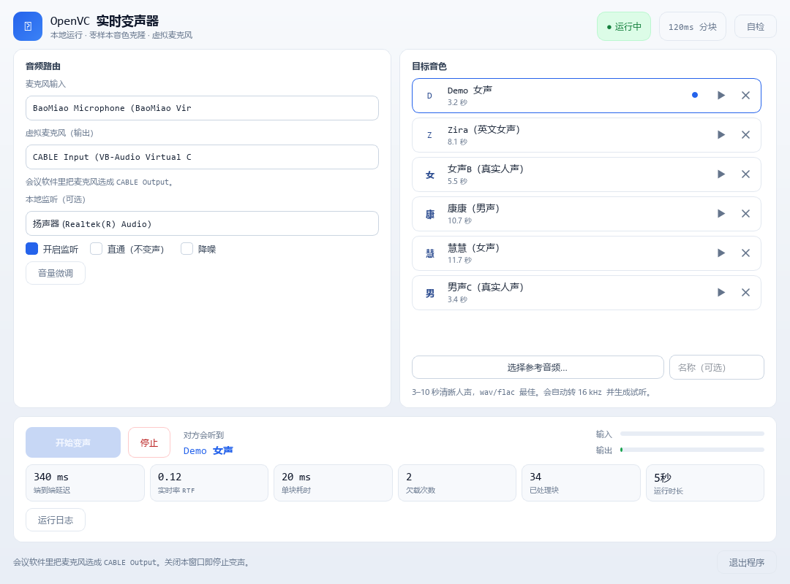

# OpenVC 实时变声器

把本机麦克风的声音**实时**换成另一个人的音色，并通过虚拟声卡喂给任意会议软件。
全部本地运行，不联网，不需要 GPU。

[](https://github.com/chenziwenhaoshuai/OpenVC/releases)
[]()
[]()

**下载**：到 [Releases](https://github.com/chenziwenhaoshuai/OpenVC/releases) 拿
`OpenVC-1.0.0.zip`（170 MB），解压即用。



> 内核：[MeanVC2](https://github.com/ASLP-lab/MeanVC2) — 18M 参数的流式零样本变声模型
> （FastU2++ ASR + CFM/DiT + Vocos 声码器），跑在 **ONNX Runtime** 上。

---

## 0. 做一个可以发给别人的文件夹

```powershell
powershell -ExecutionPolicy Bypass -File .\make_release.ps1        # 组装 release
powershell -ExecutionPolicy Bypass -File .\make_release.ps1 -Zip   # 同时压成 zip
```

产物：

| | 大小 | 说明 |
|---|---|---|
| `release\OpenVC-1.0.0\` | **338 MB** | 整个文件夹发给别人，双击即用 |
| `release\OpenVC-1.0.0.zip` | **约 165 MB** | 方便传输 |

```
OpenVC-1.0.0\
├─ OpenVC.exe          双击启动（原生窗口，不是浏览器）
├─ runtime\            内嵌 Python + Qt + ONNX Runtime
├─ onnx\               推理模型 70 MB
├─ denoise\            降噪（DeepFilterNet3）35 MB
├─ voices\             6 个内置音色
├─ 驱动\               虚拟声卡安装包（VB-CABLE 官方原版）
├─ 使用说明.txt
└─ README_APP.md
```

接收方只需要三步：**装驱动 → 双击 exe → 会议软件选 `CABLE Output`**。

### 为什么只有 302 MB

| 做法 | 体积 |
|---|---|
| PyTorch 版（最初） | 2.40 GB |
| ONNX 版 + 精简依赖 | 0.68 GB |
| **再剥离说话人编码器，改成按需下载** | **0.30 GB** |
| 加入 DeepFilterNet3 降噪 | 0.34 GB |

- 用 **ONNX Runtime** 替代 PyTorch：模型 1.88 GB → 70 MB，耗时 44 ms → 18 ms
- 用 **官方 embeddable Python + 21 KB C 启动器** 替代 PyInstaller：启动 0.73 s，无需解压
- 删掉 `torch/lib` 里只用于 C++ 编译的静态库（`dnnl.lib` 一个就 623 MB）
- **说话人编码器（369 MB）不随包分发**，第一次"添加自己的音色"时才下载

## 1. 按需下载说明

内置 6 个音色开箱即用，变声完全不需要那个 369 MB 的文件。

只有当你点「选择参考音频」上传自己的声音时，程序才提示下载**说话人编码器**
（WavLM-Large + ECAPA-TDNN，把音色算成 256 个数字）。下载一次后永久保存在
`onnx\speaker.int8.onnx`，以后不再需要。

下载做了**断点续传 + 重试 + 镜像回退**（huggingface.co → hf-mirror.com），
断网重来不会从零开始。

## 2. 实测性能（Intel Iris Xe，无独显）

| 指标 | 数值 |
|------|------|
| 窗口出现 | **1.0 s** |
| 单块耗时 | 18–28 ms / 160 ms |
| 实时率 RTF | **0.11–0.18** |
| 端到端延迟 | 340–400 ms |
| 内存 | 257 MB（开降噪 320 MB） |
| 欠载 / 溢出 | 启动 2 次后为 0 |

**音质验证（与官方 Demo 逐条对比）**

| 测试对 | 说话人相似度 | 梅尔谱相关 | F0 源→官方→我们 |
|--------|-------------|-----------|------------------|
| 00019809-400006 | 0.872 | 0.823 | 145 → 246 → 239 Hz |
| 040_001-MF6 | 0.840 | 0.840 | 239 → 242 → 242 Hz |
| 00020170-VCF1 | 0.813 | 0.852 | 205 → 137 → 144 Hz |

ONNX 与 PyTorch 同输入对比：说话人相似度 0.782 vs 0.779，梅尔谱相关 0.922。

**降噪（DeepFilterNet3，48 kHz 全频带）**

| 指标 | 关 | 开 |
|---|---|---|
| RTF | 0.13 | **0.35** |
| 每块耗时 | 21 ms | 56 ms |
| 端到端延迟 | 342 ms | 415 ms |

降噪效果（人为加噪测试）：对数谱距离相比带噪输入降低 **4.9–6.3 dB**，
安静段噪底下降 **21–38 dB**，语音能量包络相关 **0.87–0.91**（节奏完整保留）。

## 3. 产品化细节

| 功能 | 说明 |
|------|------|
| 首次引导 | 三步向导，自动检测虚拟声卡；有本地驱动包时直接指路 |
| 音色试听 | 每个音色右侧 ▶ 播放**真实转换后**的试听（现场合成并缓存） |
| 一键自检 | 播 1 kHz 测试音进虚拟声卡、再从 `CABLE Output` 录回来验证回环 |
| 设置记忆 | 设备、增益、监听与直通、上次音色，下次自动恢复 |
| 热切换音色 | 运行中直接点另一个音色，自动用新音色重启 |
| 异常告警 | RTF>0.85、持续欠载、缺虚拟声卡、模型缺失，横幅直接给建议 |
| 按需下载 | 缺少说话人编码器时提示，带进度条、可取消、断点续传 |
| 降噪 | DeepFilterNet3（官方 libDF 原生库），抑制键盘/风扇/街道噪声 |
| 原生控件 | Qt 6 QWidgets，浅色主题，自绘图标（不依赖字体） |

## 4. 从源码运行

需要 Python 3.11、Rust 工具链（只为编译降噪库）和 mingw-w64。

```powershell
git clone https://github.com/chenziwenhaoshuai/OpenVC
cd OpenVC

powershell -ExecutionPolicy Bypass -File .\setup.ps1          # 建 venv + 装依赖
powershell -ExecutionPolicy Bypass -File .\download_models.ps1  # ONNX 变声模型
powershell -ExecutionPolicy Bypass -File .\build_denoise.ps1    # 编译降噪库

python app\main_qt.py
```

打包成可分发文件夹：

```powershell
powershell -ExecutionPolicy Bypass -File .\make_release.ps1 -Zip
```

## 5. 目录

```
OpenVC/
├─ app/
│  ├─ main_qt.py           桌面入口（Qt 窗口）
│  ├─ ui/                  原生界面（theme.py 浅色主题 + main_window.py）
│  └─ backend/
│     ├─ paths.py          路径、ONNX 图与驱动包定位
│     ├─ engine_onnx.py    ONNX 流式推理（上游 VCRunner 的忠实移植）
│     ├─ downloader.py     说话人编码器按需下载（续传/重试/镜像）
│     ├─ audio.py          PortAudio 双工 + 设备 + 自检
│     ├─ voices.py         音色库与参考音频预处理
│     └─ controller.py     状态机、设置持久化、试听生成
├─ onnx/                   ONNX 图 + licenses/
├─ voices/                 音色库（wav + 嵌入 + 试听缓存）
├─ assets/                 试听用示例语音
├─ packaging/              内嵌 Python、启动器源码、驱动包、许可证
├─ tools/                  截图 / 自检 / 验证脚本
├─ packaging/              内嵌 Python、启动器源码、图标、驱动包、许可证
├─ build_portable.ps1      打包程序
├─ make_release.ps1        组装带驱动的 release
├─ build_denoise.ps1       编译降噪库（官方 libDF）
├─ download_models.ps1     下载 ONNX 变声模型
└─ setup.ps1               源码环境安装
```

## 6. 常见问题

**Q：会议软件里听不到声音**
先点「自检」。三项都通过 → 检查会议软件的麦克风是不是 `CABLE Output`。

**Q：CABLE Input 和 CABLE Output 选哪个**
- 变声器输出 → `CABLE Input`（我们把声音送进去）
- 会议软件麦克风 → `CABLE Output`（对方从这里取走）
选反了对方就听不到。

**Q：添加音色时提示下载 369 MB**
正常。内置音色不需要它，只有添加自己的音色才需要，下载一次即可。

**Q：对方说卡顿**
看顶部黄色提示条。提示"CPU 占用偏高"就关掉游戏、录屏、多余标签页。

**Q：双击没反应**
看 `data\logs\ui_crash.log`。

## 7. 致谢

- [MeanVC2](https://github.com/ASLP-lab/MeanVC2)（ASLP@NPU）— 变声模型与流式推理管线
- [MeanVC2-ONNX](https://huggingface.co/kiarina/MeanVC2-ONNX) — 社区 ONNX 导出
- [DeepFilterNet](https://github.com/Rikorose/DeepFilterNet)（Hendrik Schröter）— 降噪
- [VB-CABLE](https://vb-audio.com/Cable/) — 虚拟声卡

## 8. 许可证

- MeanVC2 权重与转换图：Apache-2.0（`onnx/licenses/`）
- 说话人编码器：CC BY-SA 3.0（Microsoft WavLM-Large + ECAPA-TDNN 派生物）
- DeepFilterNet3：MIT / Apache-2.0（官方 libDF 原生库 + 官方模型，见 `denoise/licenses/`）
- VB-CABLE 驱动：VB-Audio 免费软件，随包为官方原版未修改
- ONNX 导出：[`kiarina/MeanVC2-ONNX`](https://huggingface.co/kiarina/MeanVC2-ONNX)

## 9. 合规提醒

请只在获得授权的场景使用。用他人声音冒充他人可能违法。